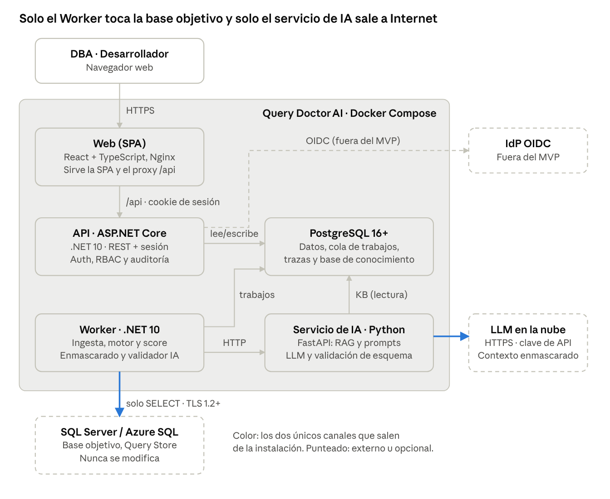
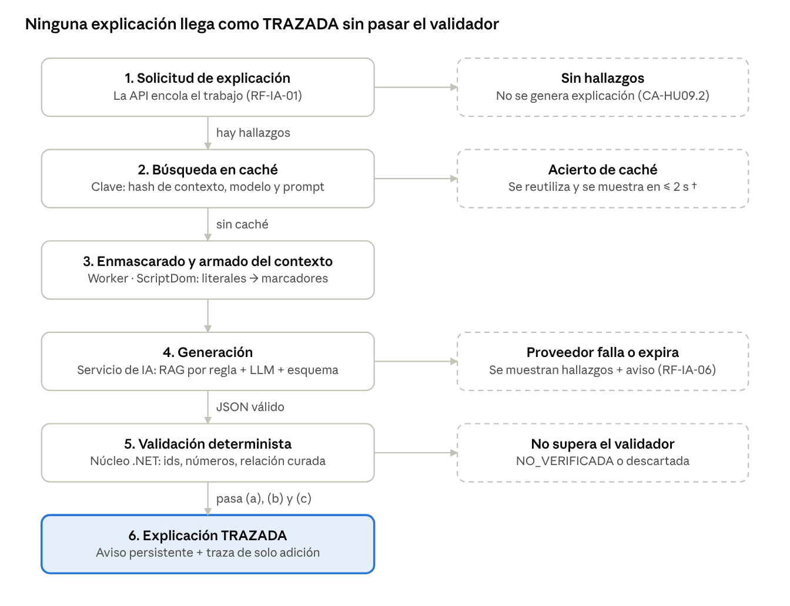

# Query Doctor AI – Documento de Arquitectura de Software (MVP)

Oct 28, 2026 · @Alvi2

Este documento define la arquitectura del MVP (Release 1.0) de Query Doctor AI y la justifica requisito por requisito contra el SRS v1.0 y su Adenda v1.1. Es un borrador: las decisiones marcadas como **Propuesta** necesitan aprobación del equipo y del tutor.

## Control del documento

| Campo                  | Valor                                                                                                                                          |
|------------------------|------------------------------------------------------------------------------------------------------------------------------------------------|
| Versión                | 0.1 (borrador para revisión del equipo)                                                                                                        |
| Base normativa         | SRS v1.0                                                                                                                                       |
| Curso                  | Proyecto de Ingeniería I, UTB, 2026-2 (31-ago al 15-nov-2026)                                                                                  |
| Tutor                  | Aisner Marrugo                                                                                                                                 |
| Responsables por vista | Ingesta y persistencia: Álvaro Ayala · Motor y score: Joel González · IA, RAG y validador: Maykol Madrid · Interfaz y gobernanza: Daniel Tache |
| Audiencia              | Equipo de desarrollo (diseño e implementación), tutor y evaluadores (rigor y trazabilidad), interesado (garantías de no intrusión y seguridad) |

**Convenciones.** Los identificadores RF-, RNF-, RES-, DA-, REG- y HU- remiten al SRS y a la adenda. Las decisiones de arquitectura se identifican como ADR-NN (Sección 11). † indica un valor provisional, igual que en el SRS.

## 1. Propósito, alcance y método

La arquitectura del MVP es un **monolito modular en .NET** (con dos procesos: API y Worker), un **servicio de IA en Python** aislado, una **SPA en React + TypeScript** y **PostgreSQL** como repositorio local. Es la estructura más pequeña que cumple los requisitos Debe del SRS v1.1 con 4 personas y unas 11 semanas.

**Alcance.** Cubre los ocho módulos funcionales del SRS (RF-CFG, RF-ING, RF-MOT, RF-SCO, RF-IA, RF-DASH, RF-TRZ, RF-EVA) y los requisitos no funcionales que imponen estructura: seguridad, rendimiento, fiabilidad, compatibilidad y mantenibilidad. Quedan fuera los temas que el SRS deja fuera del MVP (Sección 1.2.3): otros motores de bases de datos, multi-tenant, monitoreo en tiempo real y cualquier escritura sobre la base monitoreada.

**Método.**

- Las vistas siguen el modelo C4 (contexto, contenedores, componentes) y se complementan con vistas dinámicas, de datos y de despliegue.

- La organización por *stakeholders*, preocupaciones y vistas toma como marco conceptual ISO/IEC/IEEE 42010.

- Las decisiones se registran como ADR (contexto, decisión, alternativas, consecuencias), con el estado Propuesta, Aceptada o Reemplazada.

- Toda decisión remite al requisito que la origina (Sección 12). Un elemento de arquitectura sin requisito que lo justifique se considera sobrealcance.

**Relación con el SRS.** El SRS define *qué* debe hacer el sistema y deja abierta la tecnología (Sección 2.5, DA-05). Este documento cierra DA-05 y propone cómo cerrar DA-04, DA-09 y parte de DA-12 y DA-13. No modifica ningún requisito: cuando la arquitectura detecta un conflicto, lo reporta en la Sección 14.

## 2. Principios y restricciones arquitectónicas

Ocho principios derivados del SRS gobiernan cada decisión. Una propuesta que viole alguno solo se acepta si antes se modifica el SRS.

| \#  | Principio                                                                                                                                                              | Origen                                     | Consecuencia estructural                                                                                                                                                                                                |
|-----|------------------------------------------------------------------------------------------------------------------------------------------------------------------------|--------------------------------------------|-------------------------------------------------------------------------------------------------------------------------------------------------------------------------------------------------------------------------|
| P1  | **Solo lectura estricta sobre la base monitoreada.** Ningún componente emite DDL, DML ni cambios de configuración.                                                     | RES-01, RNF-SEG-01, HU-15                  | Un único componente (QueryStoreGateway) tiene acceso a las bases objetivo. Solo ejecuta sentencias constantes de una lista blanca y registra cada una (RF-TRZ-04). No existe ninguna ruta de código para forzar planes. |
| P2  | **El motor determinístico es la única fuente de verdad técnica.**                                                                                                      | SRS 1.2.1                                  | Hallazgos, score y validador viven en el núcleo .NET. El servicio de IA no calcula hallazgos ni decide su validez.                                                                                                      |
| P3  | **La salida del LLM no es confiable.**                                                                                                                                 | RF-IA-03, RNF-SEG-06/07, OWASP LLM01/05/09 | El validador corre en el núcleo, fuera del servicio de IA. La SPA renderiza la salida como texto, nunca como HTML.                                                                                                      |
| P4  | **Minimización de datos hacia el proveedor de IA, sin excepción configurable.**                                                                                        | RES-06, RNF-SEG-05 (v1.1), Ley 1581        | El enmascarado léxico ocurre en el núcleo .NET antes de que el contexto salga hacia el servicio de IA. El servicio de IA nunca ve literales.                                                                            |
| P5  | **Degradación controlada.** Si la IA falla, el diagnóstico determinístico sigue funcionando. Si falta una capacidad del motor objetivo, la función se omite con aviso. | RF-IA-06, HU-12, RNF-COM-04                | Las explicaciones son asíncronas y opcionales. Cada conexión tiene un perfil de capacidades por versión.                                                                                                                |
| P6  | **Reproducibilidad.** La misma entrada produce la misma salida y queda registro de cómo se produjo.                                                                    | RF-MOT-02, RF-SCO-03, RF-TRZ-01            | Catálogo de reglas versionado, umbrales y parámetros guardados con cada cálculo, hash canónico del contexto e identificadores deterministas.                                                                            |
| P7  | **Seguridad por defecto.** Todo acceso se autentica y se autoriza, con denegación por defecto.                                                                         | RNF-SEG-11 a 14 (v1.1)                     | La autenticación es un prerrequisito transversal de la API, no un módulo opcional. Los datos sensibles se cifran en reposo.                                                                                             |
| P8  | **Simplicidad proporcional al alcance.**                                                                                                                               | RES-04, RES-05, RIE-02                     | Sin broker de mensajes, sin lakehouse y sin microservicios por módulo. La cola de trabajos es Hangfire sobre el mismo PostgreSQL.                                                                                       |

## 3. Vista de contexto (C4, nivel 1)

El contexto es el de la Figura 2.1 del SRS con dos ajustes que exige la adenda v1.1: todo actor se autentica antes de acceder y aparece un proveedor de identidad OIDC, que queda fuera del MVP. Query Doctor AI tiene exactamente dos dependencias de salida, y ninguna escribe en sistemas del cliente.

| Elemento                                        | Tipo            | Interacción permitida                                                                                                                             | Canal                                        | Requisitos                   |
|-------------------------------------------------|-----------------|---------------------------------------------------------------------------------------------------------------------------------------------------|----------------------------------------------|------------------------------|
| DBA                                             | Persona         | Registra conexiones, ajusta umbrales, lanza ingestas, revisa diagnósticos, borra datos ingeridos. Ejecuta los cambios **fuera** de la plataforma. | HTTPS, sesión autenticada                    | HU-01, RNF-SEG-12            |
| Desarrollador                                   | Persona         | Consulta diagnósticos y explicaciones de las conexiones que tiene asignadas.                                                                      | HTTPS, sesión autenticada                    | HU-07, HU-09, RNF-SEG-12     |
| Docente o evaluador                             | Persona         | Audita la trazabilidad y ejecuta los arneses de evaluación desde el repositorio.                                                                  | HTTPS y CLI                                  | HU-14, HU-20                 |
| Base de datos objetivo (SQL Server o Azure SQL) | Sistema externo | Solo SELECT sobre la lista blanca de vistas de Query Store y de catálogo.                                                                         | TDS con TLS 1.2+ y validación de certificado | RI-01, RES-01, RNF-SEG-01/03 |
| Proveedor de LLM en la nube                     | Sistema externo | Recibe un contexto enmascarado (hallazgos, métricas, fragmentos de la base de conocimiento) y devuelve JSON estructurado.                         | HTTPS con TLS 1.2+ y clave de API            | RI-02, RES-06, RNF-SEG-05    |
| Proveedor de identidad OIDC (opcional)          | Sistema externo | Fuera del MVP: punto de extensión para delegar la autenticación en Proyecto de Ingeniería II.                                                     | HTTPS, OpenID Connect                        | RNF-SEG-13, DA-09            |

**Lo que no existe en el contexto, por diseño:** ninguna conexión de la plataforma hacia producción con permisos de escritura, ningún agente instalado en el servidor del cliente y ninguna salida de texto SQL sin enmascarar hacia Internet.

## 4. Vista de contenedores (C4, nivel 2)

Son cinco contenedores desplegados con Docker Compose. El acceso a la base objetivo y la salida hacia el LLM están en dos contenedores distintos, de modo que ningún proceso concentra ambas capacidades.

Vista de contenedores · 5 contenedores internos, 3 sistemas externos

La API nunca habla con la base objetivo ni con el LLM: todo trabajo pesado o externo pasa por una cola en PostgreSQL que procesa el Worker.

| Contenedor                  | Tecnología                                                                                | Responsabilidad                                                                                                                                                                  | No hace                                                                               | Dueño                                   |
|-----------------------------|-------------------------------------------------------------------------------------------|----------------------------------------------------------------------------------------------------------------------------------------------------------------------------------|---------------------------------------------------------------------------------------|-----------------------------------------|
| Web                         | React + TypeScript (Vite), servida por Nginx, que también hace de *reverse proxy* con TLS | Tablero, visor de planes, detalle de consulta, explicaciones con enlaces a la evidencia, trazabilidad y administración                                                           | No renderiza HTML del LLM (RNF-SEG-07). No guarda secretos.                           | Daniel                                  |
| API                         | ASP.NET Core sobre .NET 10 (LTS)                                                          | Autenticación, sesiones, RBAC, endpoints REST de lectura, alta de conexiones, encolado de trabajos, auditoría y exportación                                                      | No abre conexiones a bases objetivo ni llama al LLM                                   | Álvaro (con Daniel en el contrato REST) |
| Worker                      | .NET 10, BackgroundService                                                                | Ingesta incremental, prueba de conexión, motor de reglas, score, enmascarado, armado del contexto, validador de explicaciones, retención                                         | No expone puertos                                                                     | Álvaro (ingesta) y Joel (motor y score) |
| Servicio de IA              | Python 3.12, FastAPI                                                                      | Recuperación en la base de conocimiento (RAG), plantillas de prompt versionadas, llamada al proveedor, validación de la salida contra un esquema JSON y límites de tokens y tasa | No ve literales ni credenciales de bases. No decide si una explicación queda TRAZADA. | Maykol                                  |
| PostgreSQL 16+ con pgvector | Base relacional                                                                           | Repositorio local (RI-04), cola de trabajos, registro de trazabilidad de solo adición, auditoría y base de conocimiento con *embeddings*                                         | —                                                                                     | Álvaro                                  |

La elección de PostgreSQL frente a SQL Server se justifica en ADR-03 y la del monolito modular frente a microservicios en ADR-01.

## 5. Vista de componentes (C4, nivel 3)

La API y el Worker comparten una misma solución .NET organizada en proyectos con dependencias en una sola dirección: Domain ← Application ← Infrastructure ← hosts (Api, Worker). Cada módulo del SRS es una carpeta vertical dentro de Application. El motor de reglas es una biblioteca pura, sin E/S, para poder probarla y medirla en aislamiento (RNF-MAN-01/02, RF-EVA-01).

### 5.1 Núcleo .NET (compartido por la API y el Worker)

| Componente                                          | Módulo SRS                    | Responsabilidad                                                                                                                                                                                                                                                                                    | Interfaz principal                                           |
|-----------------------------------------------------|-------------------------------|----------------------------------------------------------------------------------------------------------------------------------------------------------------------------------------------------------------------------------------------------------------------------------------------------|--------------------------------------------------------------|
| QueryStoreGateway                                   | RF-ING, RF-CFG                | Único punto de acceso a las bases objetivo. Ejecuta sentencias constantes de la lista blanca, con Encrypt=Strict o Mandatory, TrustServerCertificate=false, LOCK_TIMEOUT corto y DEADLOCK_PRIORITY LOW. Registra cada sentencia en statement_log.                                                  | ITelemetrySource (permite agregar otros motores, RNF-FLE-02) |
| CapabilityProbe                                     | RF-CFG-03/04/07, RNF-COM-04   | Detecta la versión y la edición (SERVERPROPERTY), los permisos, el estado de Query Store (sys.database_query_store_options) y las columnas disponibles. Produce el perfil de capacidades y el nivel de soporte de la matriz.                                                                       | ICapabilityProbe                                             |
| IngestionService                                    | RF-ING-01 a 10                | Hace la ingesta incremental por marca de agua de intervalo, agrega por plan, tipo de ejecución e intervalo ponderando por ejecuciones, aplica el Top-N por consumo y hace *upsert* idempotente.                                                                                                    | Trabajo ingest                                               |
| PlanParser                                          | RF-MOT-01, RNF-COM-02         | Lee el Showplan XML con XmlReader (sin DTD y con límite de tamaño) y lo convierte en un árbol tipado de operadores. Ignora los elementos que no reconoce y conserva engine_version.                                                                                                                | IPlanParser                                                  |
| RuleEngine + reglas REG-xx                          | RF-MOT-02 a 17                | Cada regla implementa IRule y declara su id, versión, clase de evidencia y umbrales. El motor ordena los hallazgos de forma determinista y genera un finding_id a partir del hash de (plan, regla, versión, nodos).                                                                                | IRule, IRuleCatalog                                          |
| HealthScoreCalculator                               | RF-SCO-01 a 06                | Implementa la fórmula de la adenda: I(q), S(q), P(q) y H(q) = 100 − P(q). Guarda los parámetros y el desglose de cada cálculo.                                                                                                                                                                     | Función pura                                                 |
| LiteralMasker                                       | RNF-SEG-05                    | Tokeniza el texto SQL con **ScriptDom** (TSql160Parser, lexer oficial de Microsoft) y sustituye por marcadores los tokens literales y los comentarios. Hace lo mismo con los literales del plan (ConstValue, ParameterCompiledValue, ScalarString) y de los campos de evidencia.                   | IMasker                                                      |
| ExplanationContextBuilder                           | RF-IA-01/04                   | Arma el contexto canónico (hallazgos, métricas e ids de reglas), lo enmascara y calcula su hash SHA-256 sobre JSON canónico para la caché (RF-IA-07).                                                                                                                                              | —                                                            |
| ExplanationValidator                                | RF-IA-02/03/10/12, RNF-FUN-02 | Comprueba (a) que los ids existen, (b) que los números coinciden con la evidencia y (c) que cada INTERPRETACIÓN o RECOMENDACIÓN cita un fragmento con relación curada para la regla del hallazgo. Asigna TRAZADA o NO_VERIFICADA y la etiqueta de indicio.                                         | Función pura                                                 |
| TraceLog y AuditLog                                 | RF-TRZ-01 a 05                | Escriben entradas de solo adición, encadenadas por hash.                                                                                                                                                                                                                                           | —                                                            |
| Hangfire (cliente en la API, servidor en el Worker) | Transversal                   | Encola y ejecuta los trabajos probe_connection, ingest, analyze, score, explain y retention. La ingesta periódica es un trabajo recurrente por conexión. Reintentos automáticos con espera creciente. Los argumentos de los trabajos son solo identificadores, nunca SQL ni secretos (Sección 8.1) | BackgroundJob, RecurringJob                                  |
| SecretProtector                                     | RNF-SEG-04/14                 | Cifrado por sobre (*envelope*) con AES-256-GCM: una clave maestra externa (variable de entorno o gestor de secretos) cifra las claves de datos.                                                                                                                                                    | IFieldEncryptor                                              |

### 5.2 API (host ASP.NET Core)

- **Identidad:** ASP.NET Core Identity con usuarios locales, *hash* adaptativo de contraseñas y bloqueo por intentos fallidos. Cookie HttpOnly, Secure, SameSite=Strict, con expiración por inactividad de 30 min †. OIDC queda fuera del MVP (ADR-09). El primer usuario DBA se crea al arrancar con una contraseña tomada de un secreto y debe cambiarla en el primer ingreso; ese DBA da de alta a los desarrolladores y les asigna conexiones (RNF-SEG-11/13).

- **Autorización:** políticas DbaOnly y ConnectionMember con denegación por defecto (FallbackPolicy = usuario autenticado). El filtro por conexión asignada se aplica en la consulta, no en la UI (RNF-SEG-12).

- **Endpoints:** /connections, /ingestions, /queries (listado y detalle), /plans/{id}, /findings, /explanations (solicitar y consultar), /trace, /audit, /settings/thresholds y /exports. Los contratos se publican en OpenAPI.

- **Protecciones:** tokens antifalsificación, límites de tasa en el *login* y cabeceras CSP estrictas (script-src 'self').

### 5.3 Servicio de IA (Python)

| Componente      | Responsabilidad                                                                                                                                                                                                                   |
|-----------------|-----------------------------------------------------------------------------------------------------------------------------------------------------------------------------------------------------------------------------------|
| retriever       | 1\) Recupera de forma determinista los fragmentos curados por rule_id (necesarios para el criterio (c) del validador). 2) Hace búsqueda semántica opcional con pgvector sobre el corpus de buenas prácticas.                      |
| prompt_registry | Guarda las plantillas versionadas (la prompt_version va a la traza). Delimita y rotula como datos no confiables el SQL, los nombres de objetos y los valores del plan (RNF-SEG-06).                                               |
| llm_client      | Adaptador con perfiles seleccionables por LLM_PROFILE (Sección 8.3), con *timeout* de 60 s †, 2 reintentos, límites de tokens y de solicitudes por minuto, y salida estructurada contra un esquema JSON (RNF-FIA-02, RNF-SEG-08). |
| output_schema   | Usa Pydantic para validar que la salida es una lista de afirmaciones con su tipo, ids y fragmentos citados. Lo que no cumple el esquema se rechaza y nunca llega al validador.                                                    |

### 5.4 Web (SPA)

Tiene seis vistas: Consultas críticas, Detalle de consulta (métricas, planes, hallazgos, score con bandas, explicación), Visor y comparador de planes, Conexiones, Trazabilidad y auditoría, y Configuración de umbrales. Las explicaciones se renderizan como texto. Cada afirmación enlaza a sus hallazgos y nodos (RF-DASH-05) y lleva el aviso persistente de RF-IA-10 y RF-DASH-06.

## 6. Vistas dinámicas

Los cuatro flujos críticos son asíncronos: la API registra la solicitud, la encola y responde de inmediato, y el Worker la ejecuta. Así una base objetivo lenta o un proveedor de IA caído nunca bloquean la interfaz (HU-12, RNF-RND-02).

### 6.1 Registro y validación de una conexión (CU-01)

1.  El DBA autenticado envía servidor, base, plataforma y credenciales. La API cifra las credenciales con SecretProtector y encola probe_connection.

<!-- -->

1.  El Worker abre la conexión (TLS con validación de certificado, *timeout* de 15 s, RF-CFG-02) y ejecuta CapabilityProbe: versión y edición, permisos efectivos, estado de Query Store y columnas disponibles.

2.  Según la versión detectada se rechaza (anterior a 2016), se registra con aviso de nivel "Compatible sin pruebas" o se registra como "Probado". Se calcula la lista de funciones omitidas (RNF-COM-04, RF-CFG-07).

3.  Si la cuenta tiene db_owner, db_datawriter, db_ddladmin o ALTER, se muestra una advertencia (RF-CFG-05). Si Query Store está deshabilitado, la conexión queda registrada y se avisa que la ingesta se omitirá.

4.  Se escriben la auditoría (RF-TRZ-05) y el registro de sentencias emitidas (RF-TRZ-04).

### 6.2 Ingesta incremental (CU-02)

1.  El programador interno (con la misma periodicidad que el intervalo de agregación de Query Store de cada conexión, unos 5 min después de su cierre; DA-03) o un DBA encolan ingest(connection_id). La ingesta programada es un trabajo recurrente de Hangfire por conexión, y un bloqueo consultivo de PostgreSQL (pg_try_advisory_lock con el connection_id) garantiza un solo trabajo activo por conexión.

<!-- -->

5.  Se leen el estado de Query Store y la marca de agua: el último runtime_stats_interval_id consolidado.

6.  Se leen los intervalos posteriores a la marca de agua y los que siguen activos. Se agregan las filas por (plan, tipo de ejecución, intervalo) ponderando los promedios por count_executions (RF-ING-04) y se seleccionan las N consultas de mayor consumo (RF-ING-10).

7.  Se leen texto, consultas y planes nuevos. query_plan se lee como nvarchar(max) sin convertirlo a xml, para no chocar con el límite de anidamiento del tipo XML (Apéndice A, F8). Los planes nulos o inválidos se marcan como no analizables (RF-ING-09).

8.  Se hace un *upsert* idempotente por clave natural y luego se avanza la marca de agua en la misma transacción local. Repetir la ingesta no duplica registros (RF-ING-05). Si se corta la conexión, el trabajo se reintenta con espera exponencial y retoma desde la última marca de agua (RNF-FIA-01).

9.  Al terminar se encolan analyze para los planes nuevos y score para la ventana.

### 6.3 Análisis y score (CU-03, CU-04)

1.  analyze(plan_id) descifra el XML, lo procesa con PlanParser y evalúa solo las reglas cuya clase de evidencia está disponible según el perfil de capacidades.

<!-- -->

10. Los hallazgos se persisten junto con catalog_version, los umbrales usados y engine_version. Un XML inválido genera REG-11 y el análisis continúa con los demás planes (RF-MOT-16).

11. score(window) calcula C_r, s_r, I, S, P y H para cada consulta de la ventana y guarda los parámetros y el desglose (RF-SCO-02/03/05).

### 6.4 Explicación con enmascarado y validación (CU-05)

Flujo de explicación · 6 pasos, 4 salidas alternativas

Las cuatro salidas alternativas son rutas normales del diseño, no errores. En todas el usuario sigue viendo los hallazgos determinísticos, y el resultado de cada validación queda en la traza (RF-TRZ-01). El paso 3 ocurre en el Worker, así que el servicio de IA recibe el contexto ya enmascarado. El paso 5 ocurre fuera del servicio de IA, así que el modelo no puede dar por válida su propia salida.

## 7. Modelo de datos y persistencia

El modelo físico implementa las diez entidades lógicas de la Figura 4.1 del SRS y agrega las tablas que exige la adenda: usuarios y roles, auditoría, registro de sentencias y cola de trabajos. Se organiza en cinco esquemas de PostgreSQL, uno por frontera de permisos.

| Esquema  | Tablas principales                                                                               | Contenido cifrado (RNF-SEG-14)                                  | Retención (RNF-SEG-10)                                                               |
|----------|--------------------------------------------------------------------------------------------------|-----------------------------------------------------------------|--------------------------------------------------------------------------------------|
| core     | connection, query, query_text, plan, runtime_stat, ingestion_run, capability_profile             | connection.credentials, query_text.sql_text, plan.plan_xml      | query_text y plan se purgan al vencer el periodo configurado o cuando lo pide un DBA |
| analysis | finding, rule_catalog, threshold_set, health_score                                               | Los campos de evidencia que contengan literales                 | Siguen a su plan (ON DELETE CASCADE)                                                 |
| ai       | explanation, claim, claim_reference, kb_fragment (con un vector de pgvector), kb_causal_relation | explanation.body, claim.text                                    | Siguen a su consulta                                                                 |
| audit    | trace_entry, audit_event, statement_log                                                          | No hace falta: solo guardan identificadores, hashes y metadatos | Se conservan. No contienen texto SQL, así que la purga no las afecta                 |
| ops      | app_user, role, user_connection, job                                                             | app_user.password_hash (*hash*, no cifrado)                     | —                                                                                    |

**Claves e idempotencia.** runtime_stat usa como clave natural (connection_id, plan_id, execution_type, interval_id), y eso hace idempotente el *upsert* de RF-ING-05. query y plan conservan query_hash y query_plan_hash de Query Store para deduplicar sin descifrar el texto.

**Solo adición (RF-TRZ-02).** El rol de base de datos de la aplicación no tiene UPDATE ni DELETE sobre audit.\*. Un *trigger* rechaza cualquier modificación y cada entrada guarda prev_hash, con lo que un borrado directo en la base se detecta al verificar la cadena. Esto resuelve el posible conflicto entre la retención y la trazabilidad: la traza nunca guarda texto SQL, solo identificadores y el hash del contexto.

**Base de conocimiento.** kb_causal_relation (rule_id, fragment_id, relation_type) es la tabla curada que usa el criterio (c) del validador (RF-IA-03 v1.1). Se versiona junto con el catálogo de reglas y se carga por migración, sin edición desde la UI en el MVP.

**Volumen esperado.** Con N = 5 000 consultas (RNF-RND-02), 30 días y un intervalo de 60 min, el peor caso es del orden de 3,6 millones de filas en runtime_stat (5 000 × 24 × 30) por conexión. PostgreSQL lo maneja con índices compuestos por (connection_id, interval_end) y particionado mensual si hiciera falta. Es una cota superior: en la práctica no todas las consultas se ejecutan en todos los intervalos.

**Migraciones.** Se manejan con EF Core Migrations (o DbUp) versionadas en el repositorio y se aplican al arrancar el contenedor api.

## 8. Arquitectura de seguridad

Hay cuatro fronteras de confianza. Cada una tiene un control técnico concreto y una prueba que lo verifica. Ninguna depende de que el usuario o el modelo de IA se comporten bien.

| Frontera                           | Amenaza principal                                                                   | Control arquitectónico                                                                                                                                                                                                                                           | Verificación                                                                                                                        |
|------------------------------------|-------------------------------------------------------------------------------------|------------------------------------------------------------------------------------------------------------------------------------------------------------------------------------------------------------------------------------------------------------------|-------------------------------------------------------------------------------------------------------------------------------------|
| F1 · Plataforma → base objetivo    | Escritura accidental o maliciosa en producción                                      | Solo QueryStoreGateway tiene código de acceso. Ejecuta sentencias constantes de una lista blanca, sin SQL dinámico, con una cuenta de privilegio mínimo creada por el DBA mediante un *script* documentado (RNF-SEG-02). TLS 1.2+ con validación de certificado. | Prueba que revisa statement_log: solo hay SELECT (CA-HU15.2). Prueba con una cuenta que solo tiene VIEW DATABASE STATE (CA-HU15.1). |
| F2 · Núcleo → servicio de IA → LLM | Fuga de literales o datos personales (LLM02)                                        | LiteralMasker léxico con ScriptDom, sin expresiones regulares, aplicado al SQL, los comentarios, los valores del plan y la evidencia. No existe opción para desactivarlo. La red del servicio de IA no tiene ruta a las bases objetivo.                          | Suite de literales sembrados: 0 ocurrencias en las solicitudes registradas (CA-HU21.1).                                             |
| F3 · LLM → usuario                 | Inyección de instrucciones (LLM01), desinformación (LLM09), salida insegura (LLM05) | Delimitación del texto no confiable, esquema JSON obligatorio, validador determinista fuera del servicio de IA, render como texto en la SPA y CSP estricta.                                                                                                      | Suite de al menos 10 casos de inyección (RNF-SEG-06). Tasa de falsos pasantes en la auditoría manual (RNF-FUN-03).                  |
| F4 · Usuario → plataforma          | Acceso no autorizado a SQL, planes o trazas                                         | Autenticación obligatoria, RBAC con denegación por defecto, filtro por conexión asignada en la capa de datos, sesiones con expiración y bloqueo por intentos fallidos.                                                                                           | Pruebas de autorización por endpoint y rol (RNF-SEG-11/12).                                                                         |

### 8.1 Gestión de secretos y cifrado

- **En tránsito:** TLS en Nginx hacia el navegador, TLS hacia las bases objetivo y hacia el proveedor de IA. El tráfico interno pasa por la red privada de Compose.

- **En reposo:** cifrado por sobre con AES-256-GCM a nivel de campo (Sección 7). La clave maestra se inyecta como secreto de Docker o variable de entorno y nunca se versiona (RNF-SEG-04). Se recomienda cifrado de disco del host como capa adicional, sin sustituir al cifrado por campo.

- **Registros:** un filtro de *logging* elimina credenciales y claves y trunca el SQL. Los registros solo contienen SQL ya enmascarado (RNF-SEG-09).

**Hangfire.** Hangfire guarda los argumentos de cada trabajo en PostgreSQL sin cifrar y los muestra en su panel. Por eso los trabajos reciben solo identificadores (plan_id, connection_id), nunca texto SQL, planes ni credenciales (RNF-SEG-14). El panel se publica en /hangfire dentro de la API, detrás de un filtro de autorización que exige sesión con rol DBA (RNF-SEG-12). Por defecto el panel solo acepta solicitudes locales, y detrás de Nginx eso no basta como control.

### 8.2 DA-13: nombres de objetos hacia el LLM (resuelta)

**Decisión (equipo, 28-oct-2026):** en la primera versión los nombres de tablas y columnas se envían al LLM sin seudonimizar. Se declara como **riesgo residual**: un nombre de objeto (por ejemplo Pacientes.Diagnostico) puede revelar información del esquema aunque no contenga datos personales. Se acepta por tres razones:

- En el laboratorio los esquemas son públicos (TPC-H y JOB).

- Con datos reales, el candado de la Sección 8.3 impide usar perfiles gratuitos.

- El perfil de pago exige cero retención.

**Pendiente de desarrollo:** la seudonimización queda planificada para una iteración posterior. Los nombres se reemplazan por alias (T1, T1.C3) con un mapa reversible que solo guarda el núcleo, y la SPA restituye los nombres reales al mostrar la explicación. ScriptDom ya identifica los identificadores, así que el cambio se concentra en LiteralMasker y no toca la arquitectura. Cuando se implemente, el arnés de IA debe comparar ambas variantes: los alias quitan al modelo la pista semántica de los nombres y pueden bajar la calidad de las explicaciones.

### 8.3 Perfiles de proveedor de LLM y candado de datos (cierra DA-04)

El servicio de IA accede a Gemma mediante un adaptador con cuatro perfiles. El resto del código solo conoce la interfaz LLMProvider.generate(request, schema). Para cambiar de proveedor basta con cambiar la variable LLM_PROFILE, sin tocar el código.

| Perfil          | Acceso                       | Política de datos                                                                                          | Salida estructurada                        | Entornos permitidos              |
|-----------------|------------------------------|------------------------------------------------------------------------------------------------------------|--------------------------------------------|----------------------------------|
| openrouter_paid | OpenRouter, endpoint de pago | No entrena. Se exige cero retención (zdr), data_collection: deny, sin *fallbacks* y con require_parameters | Esquema JSON nativo                        | dev, lab, prod                   |
| openrouter_free | OpenRouter, variante :free   | El host puede retener o usar los datos                                                                     | Esquema en el prompt + validación Pydantic | dev y lab, con bandera explícita |
| gemini_free     | API de Gemini, plan gratuito | Google usa los datos para mejorar sus productos                                                            | Esquema en el prompt + validación Pydantic | dev y lab, con bandera explícita |
| ollama_local    | Ollama en la máquina propia  | Los datos no salen                                                                                         | Esquema JSON nativo                        | dev, lab, prod                   |

**Candado en el código.** Un perfil cuya política permite usar los datos solo arranca si APP_ENV es dev o lab y además ALLOW_DATA_SHARING_PROVIDER=true. Con APP_ENV=prod el servicio no inicia, aunque la bandera esté activa. Así RES-06 se cumple por código y no solo por política: los datos reales nunca llegan a un proveedor gratuito.

**Situación actual.** No hay presupuesto para el perfil de pago, así que el MVP se desarrolla con openrouter_free y solo con datos de laboratorio (TPC-H, JOB y literales sembrados).

**Consecuencia para la evaluación.** La traza registra el perfil, el proveedor que respondió (served_by) y la política de datos de cada explicación (RF-TRZ-01). El informe del laboratorio (RF-EVA-04) debe declarar con qué perfil se obtuvieron sus números. Si se pasa a openrouter_paid, el arnés de IA debe volver a correrse, porque otro endpoint puede servir el modelo con otra cuantización.

## 9. Atributos de calidad

Cada meta no funcional medible del SRS tiene una táctica asignada. Las metas † se calibran con el laboratorio (DA-06) y la arquitectura no supone que se cumplan antes de medirlas.

| Atributo                       | Meta                                                                      | Táctica arquitectónica                                                                                                                                                                               | Cómo se mide                                                                 |
|--------------------------------|---------------------------------------------------------------------------|------------------------------------------------------------------------------------------------------------------------------------------------------------------------------------------------------|------------------------------------------------------------------------------|
| Sobrecarga en la base objetivo | ≤ 5 % de CPU y 0 bloqueos sobre objetos de usuario † (RNF-RND-01)         | Solo vistas de Query Store, ingesta incremental, Top-N, LOCK_TIMEOUT corto, un trabajo por conexión y horario configurable                                                                           | Prueba de rendimiento con Extended Events sobre una instancia de laboratorio |
| Latencia del tablero           | Listado ≤ 2 s y detalle ≤ 3 s (p95) con 5 000 consultas † (RNF-RND-02)    | Score precalculado y guardado tras cada ingesta, paginación en servidor e índices por (conexión, ventana, score). El listado no descifra texto SQL: muestra un extracto enmascarado guardado aparte. | Prueba de carga (k6) contra la API con datos sintéticos                      |
| Latencia de IA                 | ≤ 30 s (p95) y caché ≤ 2 s † (RNF-RND-03)                                 | Trabajo asíncrono con indicador de progreso, caché por hash y *timeout* de 60 s con 2 reintentos                                                                                                     | Arnés de IA con tiempos registrados                                          |
| Análisis de un plan            | ≤ 500 ms para planes de hasta 1 MB † (RNF-RND-04)                         | XmlReader en streaming y reglas en un solo recorrido del árbol                                                                                                                                       | *Benchmark* (BenchmarkDotNet) sobre planes TPC-H y JOB                       |
| Fiabilidad                     | Reanudar sin pérdida ni duplicación (RNF-FIA-01)                          | Marca de agua transaccional, *upsert* idempotente, reintento exponencial en JobQueue                                                                                                                 | Prueba que corta la conexión a mitad de la ingesta                           |
| Compatibilidad                 | Matriz de 3 niveles (RNF-COM-01/04)                                       | CapabilityProbe: cada regla y cada columna opcional declara la capacidad que necesita y se omite con aviso si no está disponible                                                                     | Pruebas de aceptación en SQL Server 2019, 2022 y Azure SQL Database          |
| Mantenibilidad                 | Regla nueva sin tocar otras; cobertura del motor ≥ 80 % † (RNF-MAN-01/02) | IRule con registro por reflexión y un plan positivo y uno negativo por regla                                                                                                                         | CI en cada *pull request* (RNF-MAN-04)                                       |
| Observabilidad                 | Registros estructurados con correlación (RNF-MAN-05)                      | Serilog en formato JSON con correlation_id por trabajo, propagado al servicio de IA por cabecera                                                                                                     | Inspección                                                                   |
| Portabilidad                   | Instalación en ≤ 60 min con el README † (RNF-FLE-01)                      | Un solo docker compose up con un .env de ejemplo                                                                                                                                                     | Prueba con una persona ajena al equipo                                       |

**Matriz de soporte y fin de vida de SQL Server 2016.** El soporte extendido de SQL Server 2016 [terminó el 14 de julio de 2026](https://www.northdoor.co.uk/insight/blog/sql-server-2016-support-end-july-2026/), y SQL Server 2017 termina el [12 de octubre de 2027](https://sanka.com/docs/ferry/eol/sql-server/). Esto es un insumo para DA-12: la arquitectura soporta 2016 como "Compatible sin pruebas" sin costo extra, porque sus capacidades faltantes ya se manejan por el perfil de capacidades. Decisión (DA-12, 28-oct-2026): SQL Server 2016 queda como "Compatible sin pruebas". Las pruebas de aceptación cubren SQL Server 2019, 2022 y Azure SQL Database.

## 10. Vista de despliegue

El MVP se despliega en un solo host con Docker Compose y tres redes. La segmentación de red aplica la regla de la Sección 4: solo el Worker llega a las bases objetivo y solo el servicio de IA sale a Internet.

| Servicio | Imagen base                          | Puertos publicados          | Redes              | Salida permitida                                         |
|----------|--------------------------------------|-----------------------------|--------------------|----------------------------------------------------------|
| web      | nginx + build de Vite                | 443 (único puerto expuesto) | frontend           | Ninguna                                                  |
| api      | mcr.microsoft.com/dotnet/aspnet:10.0 | Ninguno (detrás de web)     | frontend, backend  | Ninguna                                                  |
| worker   | mcr.microsoft.com/dotnet/aspnet:10.0 | Ninguno                     | backend, targets   | Bases objetivo (puerto 1433 o el configurado)            |
| ai       | python:3.12-slim                     | Ninguno                     | backend, egress-ai | Solo el dominio del perfil de LLM activo (openrouter.ai) |
| db       | pgvector/pgvector (PostgreSQL 16+)   | Ninguno                     | backend            | Ninguna                                                  |

- **Secretos:** la clave maestra de cifrado, la clave de API del LLM y la contraseña de PostgreSQL se montan como *Docker secrets*, no como variables en el compose.yaml versionado.

- **Respaldo:** pg_dump programado. El respaldo hereda el cifrado por campo, así que sin la clave maestra no expone SQL ni planes.

- **Entornos:** dev (con SQL Server 2022 Developer en un contenedor como base objetivo de laboratorio) y demo (el host de la presentación). El entorno de laboratorio es el mismo que usan el arnés y el informe de RF-EVA-04.

- **Restricción de salida:** Compose no filtra por dominio de forma nativa. En el MVP la restricción de egress-ai se documenta y se aplica con el *firewall* del host o con un proxy de salida. Se declara como control parcial (Sección 14).

## 11. Registro de decisiones de arquitectura (ADR)

Se registran once decisiones. Las que cierran una decisión abierta del SRS quedan como **Propuesta** hasta que las ratifiquen el equipo y el tutor.

| ID     | Decisión                                                                                                 | Alternativas descartadas                                                                                                                            | Motivo principal                                                                                                                                                                                                                                                                                                                                                                      | Estado                                                                                       |
|--------|----------------------------------------------------------------------------------------------------------|-----------------------------------------------------------------------------------------------------------------------------------------------------|---------------------------------------------------------------------------------------------------------------------------------------------------------------------------------------------------------------------------------------------------------------------------------------------------------------------------------------------------------------------------------------|----------------------------------------------------------------------------------------------|
| ADR-01 | Monolito modular .NET con dos hosts (API y Worker)                                                       | Microservicios por módulo                                                                                                                           | 4 personas y 11 semanas (RES-04/05). Los límites de módulo se mantienen con proyectos y dependencias en una sola dirección                                                                                                                                                                                                                                                            | Aceptada (decisión del equipo, 28-oct-2026)                                                  |
| ADR-02 | IA en un servicio Python separado                                                                        | Todo en .NET (Semantic Kernel)                                                                                                                      | El ecosistema de RAG y evaluación (Pydantic, pgvector y métricas tipo RAGAS) está en Python. Además aísla la única salida a Internet                                                                                                                                                                                                                                                  | Aceptada (stack del equipo)                                                                  |
| ADR-03 | PostgreSQL 16+ con pgvector como repositorio local                                                       | SQL Server Express o Developer                                                                                                                      | Ver el detalle abajo                                                                                                                                                                                                                                                                                                                                                                  | Aceptada (decisión del equipo, 28-oct-2026; cierra la parte de persistencia de DA-05)        |
| ADR-04 | Hangfire para trabajos en segundo plano y programados, con almacenamiento en el mismo PostgreSQL         | Cola propia en PostgreSQL (SKIP LOCKED); RabbitMQ o Redis                                                                                           | Trae listos los reintentos, los trabajos recurrentes y un panel de monitoreo. Reutiliza PostgreSQL, sin otro contenedor                                                                                                                                                                                                                                                               | Aceptada (decisión del equipo, 28-oct-2026)                                                  |
| ADR-05 | Enmascarado léxico con ScriptDom en el núcleo .NET                                                       | Expresiones regulares, o enmascarar en Python con sqlglot                                                                                           | La adenda exige un analizador léxico. ScriptDom es el *parser* oficial de T-SQL ([MIT, NuGet](https://www.fuget.org/packages/Microsoft.SqlServer.TransactSql.ScriptDom/161.9109.0/lib/net6.0/Microsoft.SqlServer.TransactSql.ScriptDom.dll/Microsoft.SqlServer.TransactSql.ScriptDom/AtTimeZoneCall)), y enmascarar antes de la frontera F2 evita que el servicio de IA vea literales | Propuesta                                                                                    |
| ADR-06 | Validador en el núcleo .NET, no en el servicio de IA                                                     | Validar en Python                                                                                                                                   | El componente que genera no debe certificar su propia salida (P3)                                                                                                                                                                                                                                                                                                                     | Propuesta                                                                                    |
| ADR-07 | Sin "forzar plan" ni ninguna escritura en producción en el MVP                                           | sp_query_store_force_plan desde la UI                                                                                                               | Viola RES-01 y RNF-SEG-01 y requiere permisos de escritura                                                                                                                                                                                                                                                                                                                            | Aceptada (decisión del equipo, 28-oct-2026)                                                  |
| ADR-08 | Repositorio relacional único, sin lakehouse                                                              | MinIO + Parquet (Bronze/Silver/Gold) + DuckDB o ClickHouse                                                                                          | El volumen de una organización cabe en PostgreSQL (Sección 7). El lakehouse añade 3 tecnologías sin requisito que lo pida                                                                                                                                                                                                                                                             | Aceptada (decisión del equipo, 28-oct-2026)                                                  |
| ADR-09 | ASP.NET Core Identity con usuarios locales; OIDC fuera del MVP                                           | OIDC en el MVP; autenticación propia                                                                                                                | Cumple RNF-SEG-13, donde la delegación a OIDC es opcional ("podrá"), sin depender de un IdP en la demo ni sumar días de trabajo. OIDC queda como punto de extensión para Proyecto de Ingeniería II                                                                                                                                                                                    | Aceptada (decisión del equipo, 28-oct-2026; cierra DA-09)                                    |
| ADR-10 | Gemma vía OpenRouter, detrás de un adaptador con perfiles seleccionables por configuración (Sección 8.3) | API de Gemini directa (Gemma solo existe ahí en plan gratuito, que usa los datos); Vertex AI (exige facturación en Google Cloud); solo Ollama local | Sin presupuesto por ahora: se desarrolla con el perfil gratuito y datos de laboratorio, y se pasa a pago cambiando una variable de entorno. El código impide usar un perfil gratuito en producción                                                                                                                                                                                    | Aceptada (decisión del equipo, 28-oct-2026; cierra DA-04 salvo la versión exacta del modelo) |
| ADR-11 | Cifrado por campo AES-256-GCM en la aplicación                                                           | TDE o cifrado solo de disco                                                                                                                         | Portátil entre motores, protege también los respaldos y cumple RNF-SEG-14 aunque el disco del host no esté cifrado                                                                                                                                                                                                                                                                    | Propuesta                                                                                    |

### ADR-03 en detalle: PostgreSQL frente a SQL Server

**Decisión: PostgreSQL (aceptada el 28-oct-2026).** La diferencia no es enorme: EF Core abstrae casi todo el acceso a datos y ambos cumplen el SRS. Tres factores inclinan la balanza.

| Criterio                       | PostgreSQL 16+                                                                           | SQL Server (edición gratuita)                                                                                                                                                                                                                                                                                                   |
|--------------------------------|------------------------------------------------------------------------------------------|---------------------------------------------------------------------------------------------------------------------------------------------------------------------------------------------------------------------------------------------------------------------------------------------------------------------------------|
| Licencia para uso real         | Libre, sin límites                                                                       | Express: gratuita con límites. Developer no está licenciada para producción                                                                                                                                                                                                                                                     |
| Límites de recursos            | Los del host                                                                             | Express: buffer pool de [1 410 MB y el menor de 1 socket o 4 núcleos](https://learn.microsoft.com/en-us/sql/sql-server/editions-and-components-of-sql-server-2025). Base de datos de 10 GB hasta la versión 2022 y [50 GB en 2025](https://learn.microsoft.com/en-us/sql/sql-server/editions-and-components-of-sql-server-2025) |
| Búsqueda vectorial para el RAG | pgvector, maduro y con soporte en Python y .NET                                          | Tipo VECTOR nuevo en SQL Server 2025, [disponible también en Express](https://www.bacloud.com/en/blog/234/sql-server-express-2025-free-version-new-features-for-developers.html). Menos ejemplos y bibliotecas en Python                                                                                                        |
| Peso del contenedor            | Imagen liviana, arranca en segundos                                                      | Imagen y consumo de memoria mayores, que penalizan RNF-FLE-01 en portátiles                                                                                                                                                                                                                                                     |
| Separación conceptual          | Motor distinto del monitoreado: imposible confundir el repositorio con una base objetivo | Mismo motor que el objetivo                                                                                                                                                                                                                                                                                                     |
| Familiaridad del equipo        | A confirmar                                                                              | Probablemente mayor, por el curso y por el dominio del proyecto                                                                                                                                                                                                                                                                 |
| Almacenamiento de planes       | text                                                                                     | nvarchar(max) (el tipo xml tiene el límite de anidamiento de F8)                                                                                                                                                                                                                                                                |

Los factores decisivos son el RAG con pgvector, la ausencia de límites de licencia y recursos, y la instalación más ligera. Si en el futuro hiciera falta migrar, la alternativa compatible sería **SQL Server 2025 Express**, por su límite de 50 GB y su tipo VECTOR, sin cambios en el resto de la arquitectura.

## 12. Trazabilidad arquitectura → requisitos

Todos los módulos del SRS y todos los requisitos que la adenda v1.1 agregó o promovió tienen un componente responsable. Ningún componente existe sin requisito.

| Componente o mecanismo                                | Contenedor          | Requisitos que satisface                                                                                           |
|-------------------------------------------------------|---------------------|--------------------------------------------------------------------------------------------------------------------|
| QueryStoreGateway + statement_log                     | Worker              | RI-01, RES-01, RNF-SEG-01/03, RF-TRZ-04, HU-15                                                                     |
| CapabilityProbe                                       | Worker              | RF-CFG-02/03/04/05/07, RNF-COM-01/02/04, DA-12                                                                     |
| IngestionService + JobQueue                           | Worker              | RF-ING-01 a 12, RNF-FIA-01, RNF-RND-01                                                                             |
| PlanParser + RuleEngine + catálogo                    | Worker              | RF-MOT-01 a 17 (incluidas REG-03/04 contextuales y la advertencia de REG-02 de la v1.1), RNF-MAN-01/02, RNF-RND-04 |
| HealthScoreCalculator                                 | Worker              | RF-SCO-01 a 06                                                                                                     |
| LiteralMasker                                         | Worker              | RNF-SEG-05 (v1.1), RNF-SEG-09, HU-21                                                                               |
| ExplanationContextBuilder + caché                     | Worker              | RF-IA-01/04/07                                                                                                     |
| retriever, prompt_registry, llm_client, output_schema | Servicio de IA      | RF-IA-04/06/08/09, RNF-SEG-06/08, RNF-FIA-02                                                                       |
| ExplanationValidator + kb_causal_relation             | Worker y PostgreSQL | RF-IA-02/03/10/12, RNF-FUN-02/03                                                                                   |
| TraceLog y AuditLog (solo adición, encadenados)       | PostgreSQL          | RF-TRZ-01/02/03/05, RF-IA-11                                                                                       |
| Identity, RBAC y sesiones                             | API                 | RNF-SEG-11/12/13, SUP-06 (v1.1)                                                                                    |
| SecretProtector (cifrado por campo)                   | API y Worker        | RNF-SEG-04/14                                                                                                      |
| Trabajo de retención                                  | Worker              | RNF-SEG-10 (v1.1)                                                                                                  |
| Vistas de la SPA, render seguro y avisos              | Web                 | RF-DASH-01 a 12, RF-SCO-06, RF-IA-10/12, RNF-SEG-07, RNF-INT-01 a 03                                               |
| Arnés del motor (CLI .NET) y arnés de IA (CLI Python) | Repositorio         | RF-EVA-01 a 05, RNF-MAN-03/04                                                                                      |
| Docker Compose y README                               | Despliegue          | RNF-FLE-01                                                                                                         |
| ITelemetrySource                                      | Núcleo              | RNF-FLE-02                                                                                                         |

## 13. Diferencias con el diagrama preliminar y evolución

El diagrama preliminar del proyecto (cuatro capas con Collector Agent, *lakehouse* y "forzar plan") queda reemplazado para el MVP. Sus ideas válidas pasan al plan de Proyecto de Ingeniería II, con condiciones explícitas para retomarlas.

| Elemento del diagrama preliminar                       | Estado en el MVP                                                                        | Razón                                                                          | Condición para retomarlo (Proyecto de Ingeniería II)                                                                                                                                                          |
|--------------------------------------------------------|-----------------------------------------------------------------------------------------|--------------------------------------------------------------------------------|---------------------------------------------------------------------------------------------------------------------------------------------------------------------------------------------------------------|
| Forzar plan (sp_query_store_force_plan) desde la UI    | **Eliminado**                                                                           | Viola RES-01 y RNF-SEG-01                                                      | Solo con una nueva versión del SRS que lo autorice. Sería un módulo separado y desactivado por defecto, con credencial propia, doble confirmación humana, auditoría y reversión (sp_query_store_unforce_plan) |
| Collector Agent en .NET o Go instalado junto a la base | Sustituido por el Worker, que lee de forma remota                                       | Evita instalar software en el servidor del cliente. Una sola lengua de backend | Cuando haya instancias sin conectividad entrante o muchas bases por instancia                                                                                                                                 |
| Filtro diferencial sobre las DMVs                      | **Conservado** como marca de agua incremental                                           | Es RF-ING-05                                                                   | —                                                                                                                                                                                                             |
| Bronze en MinIO o S3 con Parquet                       | Eliminado                                                                               | Sin requisito que lo pida (ADR-08)                                             | Retención de años o un volumen que supere lo que PostgreSQL maneja bien                                                                                                                                       |
| Silver y Gold con DuckDB o ClickHouse                  | Sustituidos por tablas de PostgreSQL y el score precalculado                            | Igual                                                                          | Analítica entre muchas organizaciones (multi-tenant)                                                                                                                                                          |
| Motor dual: reglas deterministas + IA                  | **Conservado**                                                                          | Es el núcleo del SRS                                                           | —                                                                                                                                                                                                             |
| Flujo DET → AI de "banderas JSON"                      | Conservado y endurecido: contrato JSON versionado (RF-MOT-17) + enmascarado + validador | Adenda v1.1                                                                    | —                                                                                                                                                                                                             |
| Backend en ASP.NET Core **o** FastAPI                  | ASP.NET Core para la API y FastAPI solo para la IA                                      | Evita dos backends que compitan                                                | —                                                                                                                                                                                                             |
| Ollama o LLM en la nube                                | LLM en la nube detrás de un adaptador (ADR-10)                                          | Decisión del equipo                                                            | Ollama, si una organización prohíbe enviar datos fuera                                                                                                                                                        |
| Elementos que faltaban                                 | Agregados: autenticación y RBAC, cifrado, enmascarado, RAG, validador y trazabilidad    | Obligatorios por la adenda v1.1                                                | —                                                                                                                                                                                                             |

## 14. Riesgos arquitectónicos y decisiones abiertas

El mayor riesgo no es técnico sino de alcance: con la adenda, los requisitos Debe pasan al 64,6 % del total, y esta arquitectura agrega piezas obligatorias (validador con relaciones curadas, cifrado y RBAC) que consumen el margen.

### 14.1 Riesgos

| ID    | Riesgo                                                                                       | Impacto                                                                     | Mitigación                                                                                                                                  |
|-------|----------------------------------------------------------------------------------------------|-----------------------------------------------------------------------------|---------------------------------------------------------------------------------------------------------------------------------------------|
| RA-01 | La curaduría de kb_causal_relation (criterio (c) del validador) toma más tiempo del previsto | Alto: sin ella ninguna INTERPRETACIÓN ni RECOMENDACIÓN puede quedar TRAZADA | Curar primero las relaciones de las reglas Debe (REG-01 a 04). Las demás quedan NO_VERIFICADA, que es un resultado honesto                  |
| RA-02 | El validador numérico rechaza explicaciones correctas por redondeo o formato                 | Medio: baja la tasa de "superan en el primer intento" (RNF-FUN-03)          | El modelo cita los valores por id de métrica y el texto se genera con el valor formateado por el núcleo. Tolerancia de redondeo documentada |
| RA-03 | ScriptDom no tokeniza SQL truncado o inválido de Query Store                                 | Medio: riesgo de fuga si se cae a un camino sin enmascarar                  | Si falla el lexer se envía solo el contexto de hallazgos, sin texto SQL. Nunca se usan expresiones regulares como respaldo                  |
| RA-04 | La política de retención y uso de datos del proveedor de LLM no es aceptable para el cliente | Medio                                                                       | Criterio explícito al cerrar DA-04: política de no entrenamiento y retención mínima. El adaptador permite cambiar de proveedor              |
| RA-05 | La restricción de salida por dominio del contenedor ai no es nativa en Compose               | Bajo en el MVP                                                              | Firewall del host o proxy de salida. Se declara como control parcial                                                                        |
| RA-06 | Curva de aprendizaje de PostgreSQL y pgvector si el equipo viene de SQL Server               | Bajo o medio                                                                | EF Core abstrae el acceso. La alternativa SQL Server 2025 Express (ADR-03) no cambia la arquitectura                                        |
| RA-07 | Query Store en modo de captura AUTO omite consultas poco frecuentes                          | Bajo: limita la cobertura, no la corrección                                 | Mostrar el modo de captura en la conexión (RF-CFG-04) y declararlo en el informe del laboratorio                                            |

### 14.2 Decisiones abiertas que afectan la arquitectura

- [ ] **DA-04:** resuelta: Gemma vía OpenRouter con adaptador por perfiles (ADR-10, Sección 8.3). Falta fijar la versión exacta del modelo y, cuando haya presupuesto, el proveedor final del perfil de pago.

- [ ] **DA-05:** resuelta en lo que pide el SRS: .NET 10, Python, React + TypeScript y PostgreSQL (ADR-03), con Hangfire (ADR-04) y ASP.NET Core Identity (ADR-09). La estructura es un monolito modular (ADR-01).

- [x] **DA-09:** resuelta: usuarios locales con ASP.NET Core Identity; OIDC fuera del MVP (ADR-09).

- [x] **DA-12:** resuelta: SQL Server 2016 queda como "Compatible sin pruebas" (sin soporte de Microsoft desde el 14-jul-2026 y sin imagen Docker oficial en Linux). Las pruebas de aceptación cubren SQL Server 2019, 2022 y Azure SQL Database.

- [ ] **DA-13:** resuelta: la exposición de nombres de objetos se acepta como riesgo residual y la seudonimización queda planificada para una iteración posterior del desarrollo (Sección 8.2).

- [ ] **DA-03:** resuelta: la ingesta automática de cada conexión es un trabajo recurrente de Hangfire con la misma periodicidad que el interval_length_minutes de su Query Store (60 min por defecto). Corre unos 5 min después del cierre de cada intervalo, y la ingesta manual sigue disponible para el DBA.
