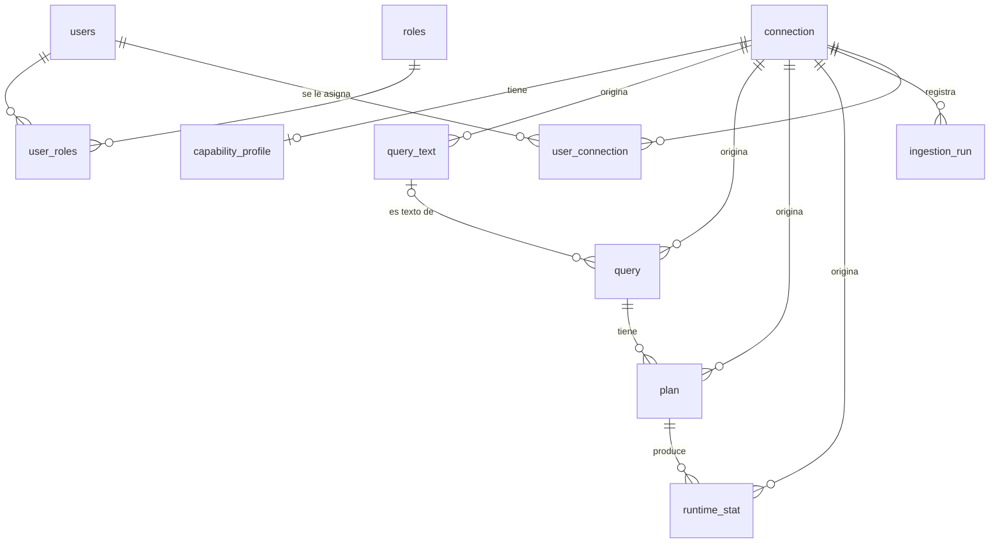

# MODELO_DATOS_v0.2.md — Modelo de datos de Query Doctor AI

> **Qué es este documento.** Describe el modelo de datos **tal como está implementado en `main`**
> tras S1-04: configuraciones de EF Core en `src/QueryDoctor.Infrastructure/Persistence/Configurations/`
> y las migraciones `Inicial` e `IndicesDeHashes`. Si este documento y el código no coinciden,
> **manda el código** y se corrige el documento.
>
> **Origen.** Empezó como una reconstrucción del modelo v0.2 de S0-07 (el diagrama original,
> "Figura 7.1", no está en el repo) con varias decisiones **propuestas**. La sección 6 indica
> cuáles quedaron aplicadas en el código y cuáles no.
>
> **Alcance.** Detalla `core` y `ops`. `analysis`, `ai` y `audit` solo se listan (sección 5).

---

## 1. Convenciones (implementadas)

| Tema | Implementación | Dónde |
|---|---|---|
| Motor | PostgreSQL (Npgsql). En S1-04 existen los esquemas `core` y `ops` | `AppDbContext`, ADR-03 |
| Nombres de tabla | `snake_case`. Las de `core` en singular; las de Identity en plural (`users`, `roles`…) | Configuraciones, `AppDbContext.OnModelCreating` |
| Nombres de columna | `snake_case` generado desde la propiedad C# (`ConnectionId` → `connection_id`) | `SnakeCase.Convert` |
| PK | `uuid` en todas las tablas de `core` salvo `runtime_stat` (`bigint` identidad). Identity: `uuid` en usuarios y roles; `integer` identidad en `user_claims` y `role_claims` | Entidades de `Domain` |
| Identificadores de Query Store | Columnas `query_store_*_id`, tipo `bigint`; **no** son la PK | Entidades `Query`, `QueryText`, `Plan` |
| Fechas | `timestamp with time zone` (`DateTimeOffset`) | Entidades |
| Enumeraciones | Se guardan como **texto con el nombre del miembro** (`HasConversion<string>()`), `varchar(32)` | Configuraciones |
| Columnas cifradas | Prefijo `encrypted_`, tipo `text`; guardan la cadena que devuelve `IFieldEncryptor.Encrypt` (S1-05). La base nunca ve el texto plano | RNF-SEG-04/14 |
| Planes | `plan.encrypted_plan_xml` es `text`; el XML nunca se guarda ni se lee como tipo `xml` | §6.2 (F8) |
| Hashes de Query Store | `varchar(64)` con el hash en hexadecimal (no `bytea`) | `Query.QueryHash`, `Plan.QueryPlanHash` |
| Clave natural | Índice **único** (UK) sobre `connection_id` + identificador de Query Store | §7, RF-ING-05 |
| Borrado | Todo lo ingerido cuelga de `connection` con `ON DELETE CASCADE`; la confirmación previa la exige la aplicación | RF-CFG-06, §7 |
| Nombres de restricciones | Los de EF: `PK_<tabla>`, `FK_<tabla>_<principal>_<columna>`, `IX_<tabla>_<columnas>` | Migraciones |

---

## 2. Diagrama (core y ops)

---

## 3. Esquema `core`

### 3.1 `core.connection` — Conexión objetivo (E-01)

| Columna | Tipo | Nulo | Descripción |
|---|---|---|---|
| id | uuid | no | PK |
| platform | varchar(32) | no | `SqlServer`, `AzureSqlDatabase` |
| server | varchar(255) | no | Servidor (RF-CFG-01) |
| database_name | varchar(128) | no | Base de datos (RF-CFG-01) |
| authentication_method | varchar(32) | no | `SqlAuthentication` |
| encryption | varchar(32) | no | `Mandatory`, `Strict` (RNF-SEG-03) |
| encrypted_credentials | text | sí | Credenciales cifradas (RNF-SEG-04) |
| status | varchar(32) | no | `Active`, `Disabled` |
| last_consolidated_interval_id | bigint | sí | Marca de agua: último `runtime_stats_interval_id` consolidado (§6.2) |
| created_at | timestamptz | no | |
| updated_at | timestamptz | no | |

- **PK:** `PK_connection (id)`
- **UK:** `IX_connection_server_database_name (server, database_name)`. La comparación **distingue
  mayúsculas** (índice B-tree normal): ver pendiente en la sección 7.
- **FK:** ninguna.

### 3.2 `core.capability_profile` — Perfil de capacidades

Resultado del último sondeo (`CapabilityProbe`, S1-09); se sobrescribe en cada sondeo.

| Columna | Tipo | Nulo | Descripción |
|---|---|---|---|
| id | uuid | no | PK |
| connection_id | uuid | no | FK → connection |
| engine_version | varchar(64) | no | Versión del motor (RF-CFG-03) |
| edition | varchar(128) | sí | Edición |
| support_level | varchar(32) | no | `Tested`, `CompatibleUntested`, `NotSupported` (RF-CFG-07) |
| has_view_database_state | boolean | no | Permiso `VIEW DATABASE STATE` (RF-CFG-05) |
| has_excessive_permissions | boolean | no | La cuenta tiene permisos de escritura: advertir (RF-CFG-05) |
| query_store_actual_state | varchar(64) | sí | Estado actual de Query Store (RF-CFG-04) |
| query_store_desired_state | varchar(64) | sí | Estado deseado (RF-CFG-04) |
| query_store_read_only_reason | varchar(128) | sí | Motivo de solo lectura (RF-CFG-04) |
| interval_length_minutes | integer | sí | Intervalo de agregación (RF-CFG-04, DA-03) |
| capture_mode | varchar(64) | sí | Modo de captura (RF-CFG-04) |
| retention_days | integer | sí | Retención (RF-CFG-04) |
| omitted_features_json | text | sí | Funciones omitidas en esta versión, como JSON en texto (RF-CFG-07) |
| probed_at | timestamptz | no | Cuándo se sondeó |

- **PK:** `PK_capability_profile (id)`
- **UK:** `IX_capability_profile_connection_id (connection_id)`: un perfil por conexión.
- **FK:** `connection_id` → `core.connection(id)` **ON DELETE CASCADE**.

### 3.3 `core.query_text` — Texto de consulta (E-02, parte)

| Columna | Tipo | Nulo | Descripción |
|---|---|---|---|
| id | uuid | no | PK |
| connection_id | uuid | no | FK → connection |
| query_store_text_id | bigint | no | `query_text_id` de Query Store (RF-ING-01) |
| encrypted_sql_text | text | sí | Texto SQL cifrado; `null` tras la purga por retención (RNF-SEG-10/14) |
| ingested_at | timestamptz | no | (RF-ING-07) |

- **PK:** `PK_query_text (id)`
- **UK:** `IX_query_text_connection_id_query_store_text_id (connection_id, query_store_text_id)`
- **FK:** `connection_id` → `core.connection(id)` **ON DELETE CASCADE**.

### 3.4 `core.query` — Consulta (E-02)

| Columna | Tipo | Nulo | Descripción |
|---|---|---|---|
| id | uuid | no | PK |
| connection_id | uuid | no | FK → connection |
| query_store_query_id | bigint | no | `query_id` de Query Store (RF-ING-01) |
| query_text_id | uuid | sí | FK → query_text |
| query_hash | varchar(64) | sí | `query_hash` de Query Store en hexadecimal |
| origin_context | varchar(512) | sí | Contexto de origen (p. ej., objeto contenedor) |
| ingested_at | timestamptz | no | (RF-ING-07) |

- **PK:** `PK_query (id)`
- **UK:** `IX_query_connection_id_query_store_query_id (connection_id, query_store_query_id)`
- **Índices no únicos:** `IX_query_connection_id_query_hash (connection_id, query_hash)` —
  deduplicar sin descifrar (§7); no puede ser único porque varias consultas comparten hash.
  `IX_query_query_text_id (query_text_id)` — creado por EF para la FK.
- **FK:** `connection_id` → `core.connection(id)` **ON DELETE CASCADE**;
  `query_text_id` → `core.query_text(id)` **ON DELETE SET NULL** (al purgar el texto se conserva la consulta).

### 3.5 `core.plan` — Plan de ejecución (E-03)

| Columna | Tipo | Nulo | Descripción |
|---|---|---|---|
| id | uuid | no | PK |
| connection_id | uuid | no | FK → connection (repetida para declarar la UK) |
| query_id | uuid | no | FK → query |
| query_store_plan_id | bigint | no | `plan_id` de Query Store (RF-ING-01) |
| query_plan_hash | varchar(64) | sí | `query_plan_hash` de Query Store en hexadecimal |
| encrypted_plan_xml | text | sí | Showplan XML cifrado; `null` si no se recuperó o tras la purga (RF-ING-09) |
| engine_version | varchar(64) | sí | Versión del motor que compiló el plan |
| analysis_status | varchar(32) | no | `Pending`, `Analyzable`, `NotAnalyzable` (RF-ING-09) |
| not_analyzable_cause | varchar(512) | sí | Causa cuando no es analizable (RF-ING-09) |
| ingested_at | timestamptz | no | (RF-ING-07) |

- **PK:** `PK_plan (id)`
- **UK:** `IX_plan_connection_id_query_store_plan_id (connection_id, query_store_plan_id)`
- **Índices no únicos:** `IX_plan_connection_id_query_plan_hash (connection_id, query_plan_hash)`
  (§7); `IX_plan_query_id (query_id)` — creado por EF para la FK.
- **FK:** `connection_id` → `core.connection(id)` **ON DELETE CASCADE**;
  `query_id` → `core.query(id)` **ON DELETE CASCADE**.

### 3.6 `core.runtime_stat` — Estadística de ejecución (E-04)

Una fila por plan, tipo de ejecución e intervalo, ya agregada (RF-ING-04). Tiempos en µs, como Query Store.

| Columna | Tipo | Nulo | Descripción |
|---|---|---|---|
| id | bigint | no | PK, identidad (`GENERATED BY DEFAULT AS IDENTITY`) |
| connection_id | uuid | no | FK → connection |
| plan_id | uuid | no | FK → plan |
| execution_type | varchar(32) | no | `Regular`, `Aborted`, `Exception` |
| interval_id | bigint | no | `runtime_stats_interval_id` de Query Store |
| interval_start | timestamptz | no | Inicio del intervalo |
| interval_end | timestamptz | no | Fin del intervalo |
| execution_count | bigint | no | (RF-ING-02) |
| avg_duration_microseconds | double precision | no | (RF-ING-02) |
| avg_cpu_time_microseconds | double precision | no | (RF-ING-02) |
| avg_logical_io_reads | double precision | no | (RF-ING-02) |
| avg_physical_io_reads | double precision | no | (RF-ING-02) |
| avg_logical_io_writes | double precision | no | (RF-ING-02) |
| avg_row_count | double precision | no | (RF-ING-02) |
| avg_dop | double precision | no | (RF-ING-02) |
| avg_max_used_memory_pages | double precision | no | (RF-ING-02) |
| avg_temp_db_space_pages | double precision | sí | Solo 2017+ y Azure SQL (RF-ING-03) |
| avg_log_bytes_used | double precision | sí | Solo 2017+ y Azure SQL (RF-ING-03) |
| ingested_at | timestamptz | no | (RF-ING-07) |

- **PK:** `PK_runtime_stat (id)`
- **UK:** `(connection_id, plan_id, execution_type, interval_id)` — hace idempotente el *upsert*
  (§7, RF-ING-05). Nombre truncado por PostgreSQL a 63 caracteres:
  `IX_runtime_stat_connection_id_plan_id_execution_type_interval_~`.
- **Índices no únicos:** `IX_runtime_stat_connection_id_interval_end (connection_id, interval_end)`
  para el tablero (§7); `IX_runtime_stat_plan_id (plan_id)` — creado por EF para la FK.
- **FK:** `connection_id` → `core.connection(id)` **ON DELETE CASCADE**;
  `plan_id` → `core.plan(id)` **ON DELETE CASCADE**.

### 3.7 `core.ingestion_run` — Ejecución de ingesta

| Columna | Tipo | Nulo | Descripción |
|---|---|---|---|
| id | uuid | no | PK |
| connection_id | uuid | no | FK → connection |
| trigger | varchar(32) | no | `Manual`, `Scheduled` (RF-ING-06) |
| status | varchar(32) | no | `Running`, `Succeeded`, `Failed`, `Skipped` (RNF-FIA-01) |
| started_at | timestamptz | no | |
| finished_at | timestamptz | sí | |
| rows_upserted | integer | sí | Filas insertadas o actualizadas |
| error_cause | varchar(1024) | sí | Causa del fallo; sin texto SQL ni literales (RNF-SEG-09) |

- **PK:** `PK_ingestion_run (id)`
- **UK:** ninguna (no tiene clave natural).
- **Índices no únicos:** `IX_ingestion_run_connection_id_started_at (connection_id, started_at)`.
- **FK:** `connection_id` → `core.connection(id)` **ON DELETE CASCADE**.

---

## 4. Esquema `ops`

Usuarios y roles los gestiona **ASP.NET Core Identity** (`IdentityDbContext<ApplicationUser,
ApplicationRole, Guid>`), con sus tablas movidas a `ops` y columnas en `snake_case`.

| Tabla | Equivale a (Identity) | PK | UK / índices | FK (todas ON DELETE CASCADE) |
|---|---|---|---|---|
| `ops.users` | AspNetUsers | `id` uuid | `UserNameIndex (normalized_user_name)` **único**; `EmailIndex (normalized_email)` **no único** | — |
| `ops.roles` | AspNetRoles | `id` uuid | `RoleNameIndex (normalized_name)` **único** | — |
| `ops.user_roles` | AspNetUserRoles | `(user_id, role_id)` | `IX_user_roles_role_id` | `user_id` → users, `role_id` → roles |
| `ops.user_claims` | AspNetUserClaims | `id` integer identidad | `IX_user_claims_user_id` | `user_id` → users |
| `ops.role_claims` | AspNetRoleClaims | `id` integer identidad | `IX_role_claims_role_id` | `role_id` → roles |
| `ops.user_logins` | AspNetUserLogins | `(login_provider, provider_key)` | `IX_user_logins_user_id` | `user_id` → users |
| `ops.user_tokens` | AspNetUserTokens | `(user_id, login_provider, name)` | — | `user_id` → users |
| `ops.user_connection` | — (propia) | `(user_id, connection_id)` | `IX_user_connection_connection_id` | `user_id` → users, `connection_id` → core.connection |

- **`ops.users`**: columnas estándar de Identity (`user_name`, `normalized_user_name`, `email`,
  `normalized_email`, `email_confirmed`, `password_hash`, `security_stamp`, `concurrency_stamp`,
  `phone_number`, `phone_number_confirmed`, `two_factor_enabled`, `lockout_end`, `lockout_enabled`,
  `access_failed_count`) más dos propias: `must_change_password` boolean no nulo (primer ingreso,
  RNF-SEG-13) y `created_at` timestamptz no nulo.
- **`ops.user_connection`**: `user_id` uuid, `connection_id` uuid, `assigned_at` timestamptz no nulo.
  Qué conexiones puede consultar un usuario Desarrollador (RNF-SEG-12).
- **Roles sembrados** en la migración `Inicial` con identificadores fijos: `DBA`
  (`6f1c3b0e-…-1001`) y `Desarrollador` (`6f1c3b0e-…-1002`) (RNF-SEG-12).
- **No existe `ops.job`** en las migraciones de EF (ver MD-08).

---

## 5. Esquemas fuera de S1-04 (aún no existen en la base)

| Esquema | Tablas previstas (§7) | Tarea que las crea |
|---|---|---|
| analysis | finding, rule_catalog, threshold_set, health_score | S1-13, S2-02 |
| ai | explanation, claim, claim_reference, kb_fragment, kb_causal_relation | S1-17, S2-05 |
| audit | trace_entry, audit_event, statement_log (solo adición, `prev_hash`) | S2-06; statement_log: S1-08 usa hoy un escritor en memoria |

---

## 6. Decisiones de la propuesta: qué quedó aplicado

Estado respecto del código en `main`. **Aplicada** = el código hace lo propuesto.
**Parcial** = una parte sí y otra no. **No aplicada** = el código hace otra cosa o nada.
Las no aplicadas siguen abiertas: cambiarlas requiere una tarea y una migración nuevas.

| ID | Decisión propuesta | Estado | Qué hay en el código |
|---|---|---|---|
| MD-01 | Claves naturales con el identificador de Query Store | **Aplicada** | UK `(connection_id, query_store_text_id \| query_store_query_id \| query_store_plan_id)`. Nombres `query_store_*_id` en vez del prefijo `qs_` |
| MD-02 | `query_hash` y `query_plan_hash` con índice **no** único | **Aplicada** | Migración `IndicesDeHashes`. Tipo `varchar(64)` hexadecimal, no `bytea` |
| MD-03 | PK `uuid` en conexión y usuarios; `bigint` en las de volumen | **Parcial** | `uuid` en todas las de `core` (también `query_text`, `query`, `plan`, `capability_profile`, `ingestion_run`); `bigint` solo en `runtime_stat` |
| MD-04 | Marca de agua en `connection` y copiada en cada `ingestion_run` | **Parcial** | Existe `connection.last_consolidated_interval_id`; `ingestion_run` no guarda marca de agua |
| MD-05 | `interval_start/end` dentro de `runtime_stat`, sin tabla de intervalos | **Aplicada** | |
| MD-06 | Un `capability_profile` por conexión, sobrescrito en cada sondeo | **Aplicada** | UK `(connection_id)` |
| MD-07 | Unicidad de `(server, database_name)` en minúsculas y de `name` | **Parcial** | UK `(server, database_name)` sin normalizar mayúsculas; no hay columna `name` |
| MD-08 | Hangfire gestiona sus tablas; `ops.job` fuera de EF | **Aplicada** | EF no crea `ops.job`; las tablas de Hangfire llegan en S1-10 |
| MD-09 | Correo único en usuarios | **No aplicada** | `EmailIndex` no es único (por defecto de Identity). Se puede exigir con `RequireUniqueEmail` en S1-06 |
| MD-10 | Columnas cifradas como `text` | **Aplicada** | Verificado: `IFieldEncryptor.Encrypt` devuelve `string` |
| MD-11 | Índice único parcial: una ingesta `Running` por conexión | **No aplicada** | Solo índice no único `(connection_id, started_at)`; queda el bloqueo consultivo de §6.2 (S1-11) |

Otras diferencias con la propuesta (sin ID): `connection` no tiene `name` ni `created_by`;
`capability_profile` no tiene `engine_major` ni `has_tempdb_log_columns` (se usa
`omitted_features_json`, `text`, no `jsonb`); `ingestion_run` no tiene conteos separados ni
`correlation_id` (tiene `rows_upserted` y `error_cause`); `user_connection` no tiene
`assigned_by`; los enumerados se guardan como nombres en inglés (`Active`, `Pending`…) y no
como `ACTIVA`, `PENDIENTE`…; `query.query_text_id` es nulo (por `SET NULL` en la purga);
`runtime_stat` indexa `(connection_id, interval_end)` y no `(connection_id, interval_id)`.

## 7. Pendiente

- **Mayúsculas en `connection(server, database_name)`:** hoy `SRV01/Ventas` y `srv01/ventas`
  pasan la UK. Se resuelve en **S1-09** (normalizar al registrar o índice sobre `lower(...)`).
- **Prueba de integración contra PostgreSQL** que demuestre que las UK rechazan duplicados
  (hoy no hay pruebas contra una base real).
- ~~Verificar los tipos de Query Store al implementar S1-11.~~ **Hecho en S1-11:** `execution_type` es `tinyint`
  (0 Regular, 3 Aborted, 4 Exception; otro valor se descarta con aviso); `query_hash` y `query_plan_hash` son
  `binary(8)` y se guardan como 16 caracteres hexadecimales en mayúsculas, sin `0x`. La memoria máxima se lee de
  `avg_query_max_used_memory` (S1-07). S1-11 no cambió el esquema: no hay migración.
- `query.origin_context` queda `NULL` con la cuenta de mínimo privilegio: SQL Server oculta `OBJECT_NAME` sin
  `VIEW DEFINITION` (medido en el laboratorio, S1-11).
- Si aparece el diagrama original de S0-07, compararlo con este documento.
- Agregar este modelo como Figura 7.1 del documento de arquitectura.
